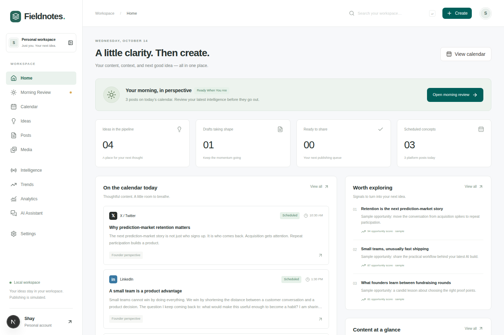
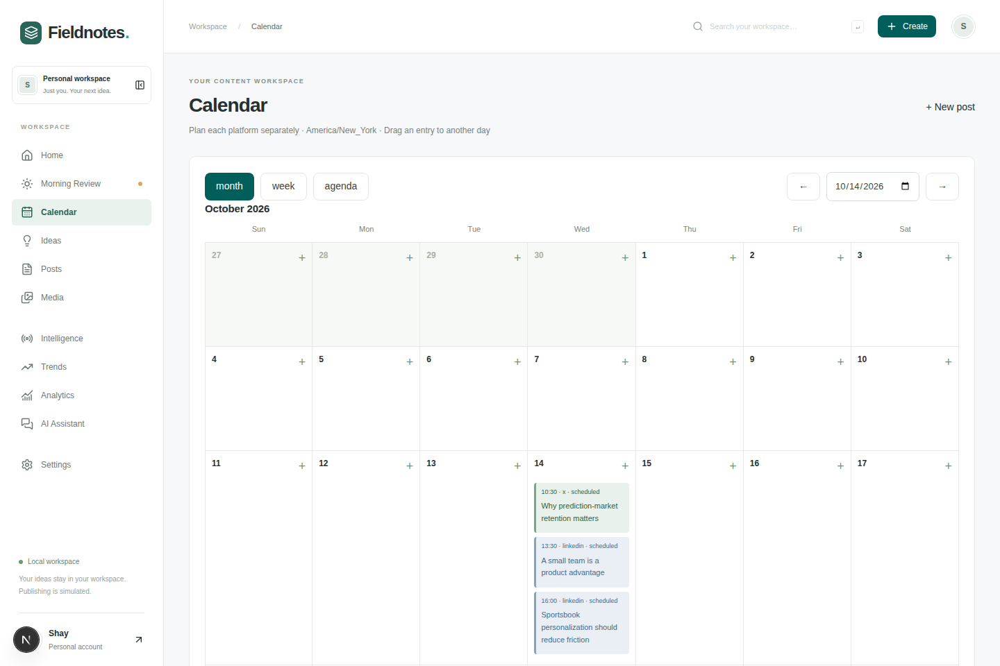
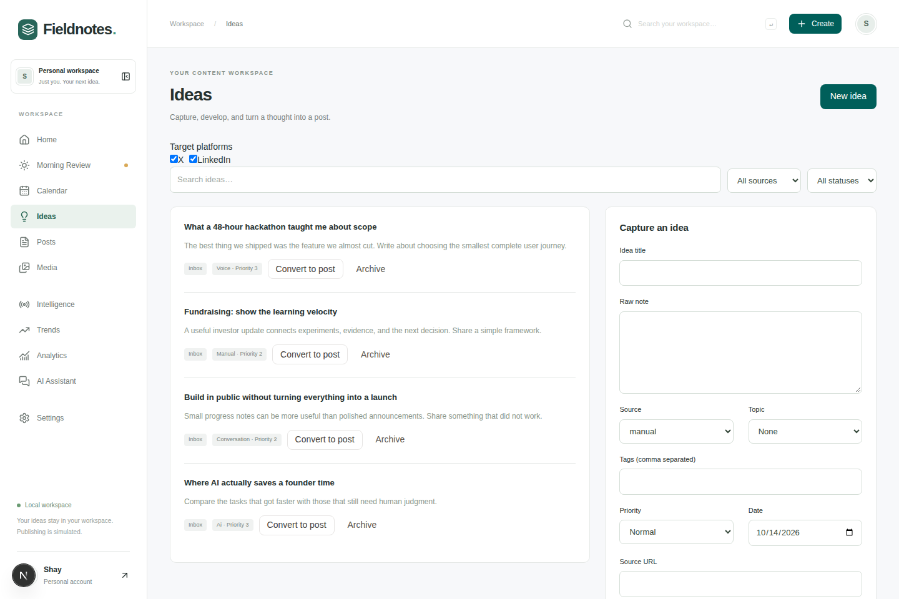
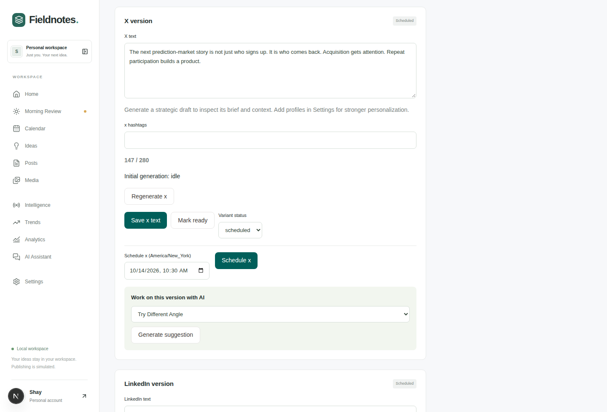
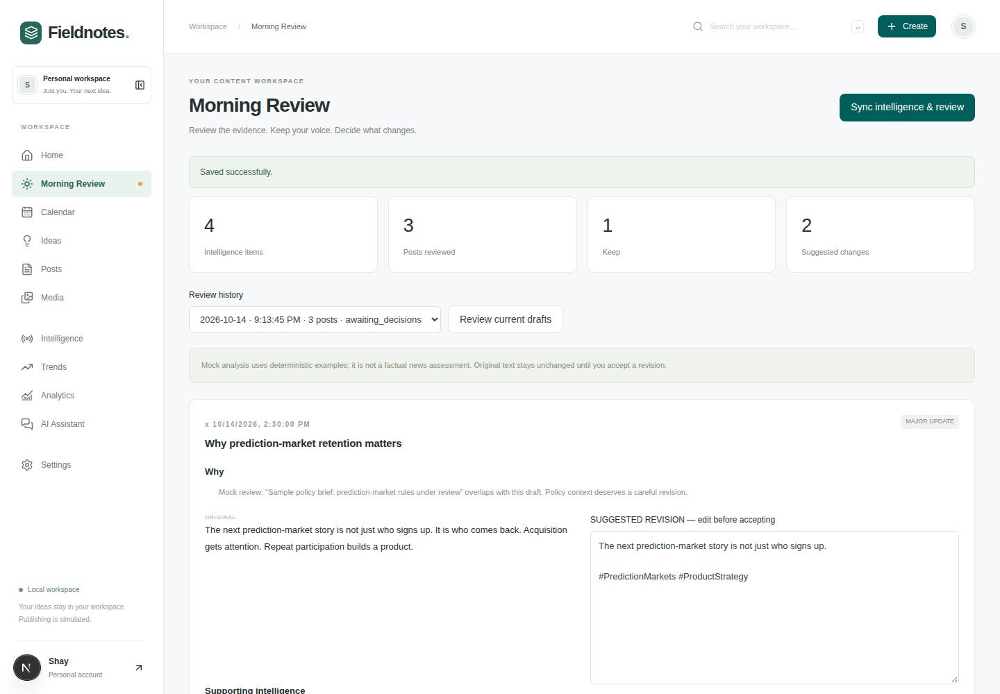
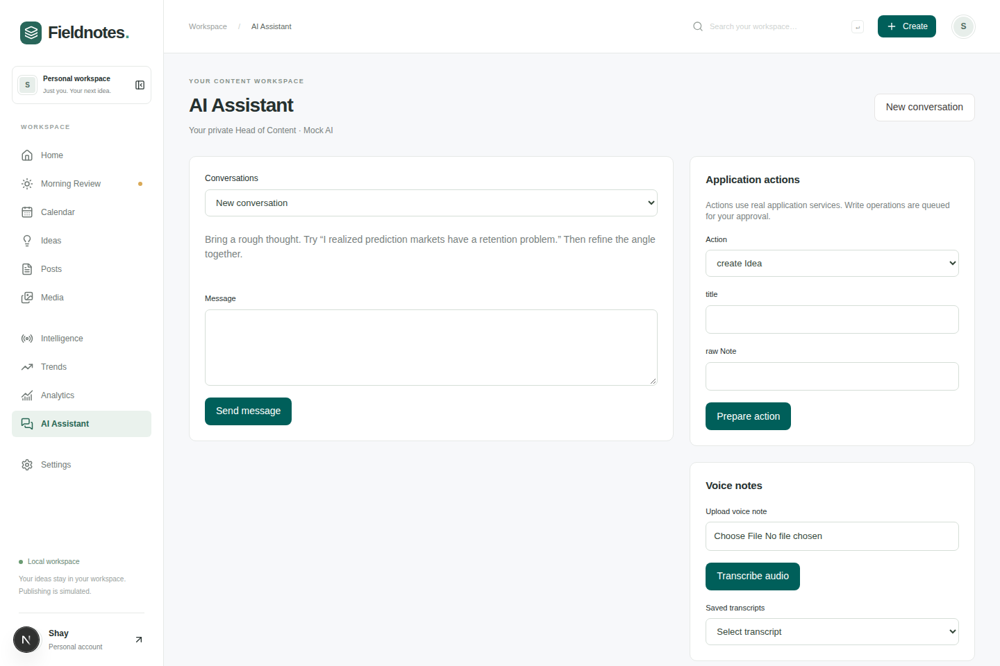

# Fieldnotes

Fieldnotes is a local, single-user workspace for turning notes into X and LinkedIn drafts, checking those drafts against research, and putting them on a calendar. It is an unfinished portfolio project by Shay Bouchles. It runs on this machine with sample data and no API keys. Scheduling updates the local calendar. Nothing is sent to X or LinkedIn.



## What it does

The App Router exposes these screens:

| Route                              | What you can do                                                                                                                                                                                                                                      |
| ---------------------------------- | ---------------------------------------------------------------------------------------------------------------------------------------------------------------------------------------------------------------------------------------------------- |
| `/`                                | Today’s scheduled variants, pipeline counts, intelligence rows, and seeded impression totals. “Worth exploring” lists new content opportunities, or seeded trend rows labeled sample when none are new. The impression chart uses fixed bar heights. |
| `/ideas`                           | Save notes, filter them, and convert a note into a post for the selected platforms (X and LinkedIn).                                                                                                                                                 |
| `/create`, `/posts`, `/posts/[id]` | Edit one concept with separate X and LinkedIn variants, attach media, duplicate, archive, or delete.                                                                                                                                                 |
| `/calendar`                        | Month, week, and agenda views in `APP_TIMEZONE`. Create from a day and drag an entry to another day.                                                                                                                                                 |
| `/media`                           | Upload JPEG, PNG, WebP, GIF, MP4, WebM, MP3, M4A, WAV, or OGG up to 20 MB. Preview local files and filter used or unused assets.                                                                                                                     |
| `/intelligence`                    | Sync a read-only Notion daily brief, or the sample provider when `NOTION_API_KEY` is empty. Search, filter, dismiss, and save an item as an idea. Each row shows its source.                                                                         |
| `/morning-review`                  | Sync intelligence and review scheduled drafts. Recommendations are `KEEP`, `MINOR_UPDATE`, `MAJOR_UPDATE`, `REPLACE`, or an additional-post suggestion. Original text stays until you accept a revision.                                             |
| `/trends`                          | Act on content opportunities from intelligence: create an idea, draft X or LinkedIn, save for later, or dismiss. Seeded trend signals can also be saved as ideas.                                                                                    |
| `/analytics`                       | Read seeded metric rows. The page states that no live analytics provider is connected.                                                                                                                                                               |
| `/assistant`                       | Chat with Groq when `GROQ_API_KEY` is set, otherwise with the mock assistant. Write tools wait for approval. Voice notes can be transcribed, edited, and saved as ideas.                                                                             |
| `/settings`                        | Set platform-generation and hashtag preferences, four content profiles, the writing profile, topics, and view provider status plus recorded token usage.                                                                                             |
| `/search`                          | Substring search over the loaded posts, ideas, media, intelligence, and trends.                                                                                                                                                                      |

Idea conversion can generate both platform drafts immediately. That default follows `AUTO_GENERATE_POST_VARIANTS` until Settings saves an override. Generation asks the model for `{ platform, body, hashtags }`, then checks X with the `twitter-text` weighted counter (280, including hashtags and shortened URLs). Invalid output is repaired up to three attempts. A failed generation keeps the existing draft. Regenerating an existing variant stores a suggestion until you approve it.

When a model is configured, drafting also runs the content brain in `services/content-brain.ts`: it extracts a few knowledge items from the note, builds one strategic brief, drafts the platform, critiques that draft, and allows one revision when the critique finds a material weakness or an unsupported claim. A remaining unsupported claim is rejected and the previous text is left in place. On the editor, “Why this draft?” and “View context used” read that stored brief. Content profiles start empty. The seed does not fill them.

The mock assistant queues an approval when a message starts with `Create idea:` or `Create post:`. Any other mock reply is a fixed three-angle template. With Groq, the assistant can choose tools for up to three rounds. Those tools search the workspace and can queue idea, post, variant, schedule, attachment, and intelligence-to-idea changes. There is no publish tool.

Sample intelligence, sample metrics, and sample trends are labeled in the interface. They are fixtures for the local workspace.

## Stack

- Node.js 22 or newer (`package.json` `engines`)
- Next.js 16 App Router, React 19, TypeScript (strict)
- Tailwind CSS 4
- Drizzle ORM and ordered SQL migrations in `drizzle/`
- Embedded PostgreSQL through PGlite for local mode; a Neon HTTP client is present for a later hosted database
- Auth.js (`next-auth` v5) with a Google provider limited to `OWNER_EMAIL`
- Zod, `twitter-text`, Lucide, and the Radix / `class-variance-authority` button
- Vitest for unit and integration tests, Playwright for the browser workflow

## Architecture

```text
Browser
  app/page.tsx, app/[section]/page.tsx, app/posts/[id]/page.tsx
        │  server actions
        ▼
  app/manage-actions.ts  ·  app/actions.ts
        │
        ▼
  services/          content, platform generation, content brain,
                     intelligence, assistant, jobs
        │
        ├── db/      Drizzle schema (39 tables) + PGlite, or Neon when not local
        └── providers/
              Groq chat + speech     when GROQ_API_KEY is set
              Notion read-only       when NOTION_API_KEY is set
              local media files
              mocks                  AI, speech, intelligence, and the unused
                                     publisher / analytics / trends / chat /
                                     media-understanding adapters
```

`providers/index.ts` is server-only and throws outside local mode: `Production providers are not enabled in this local workspace.` `LOCAL_DEV_MODE=true` also throws if `VERCEL` is set. In local development the app signs in as the seeded owner (`name: Shay`, `email: owner@localhost.test`) through `MockAuthenticationProvider`. `next start` is production, so it needs `LOCAL_DEV_MODE=true` to keep that path.

Migrations and the idempotent seeds run on the first database open. Local data lives in `.local/postgres` and uploads in `.local/media` (both gitignored). `LOCAL_DATA_DIR` moves that root. Run one process per data directory.

Groq calls use `AI_PRIMARY_MODEL`, with `AI_FAST_MODEL` for the fast tier and `AI_TRANSCRIPTION_MODEL` for speech. `lib/ai-budget.ts` and `providers/groq.ts` keep a process-local reservation ledger at 30 requests/minute, 1,000/day, 8,000 tokens/minute, and 200,000 tokens/day per model. The ledger resets when the process restarts. Optional `AI_MODEL_PRICING_JSON` only estimates cost from token counts.

`services/jobs.ts` exports `dailyWorkflow` (sync, then review) and `isReviewDue`. The Morning Review buttons call the workflow. `isReviewDue` has no caller, and no scheduler process is installed.

Deeper adapter notes: [`providers/README.md`](providers/README.md). A dated live generation note: [`docs/platform-generation-demo.md`](docs/platform-generation-demo.md). The finish plan: [`docs/ROADMAP.md`](docs/ROADMAP.md).

## Screenshots

Taken from `npm run dev` on 14 October 2026 with the seeded workspace, no Groq key, and no Notion key. Publishing stayed off. The Morning Review frame is the mock provider’s review of that day’s three scheduled variants.











## Setup

```bash
npm install
cp .env.example .env.local
npm run dev
```

Open http://127.0.0.1:3000. The dev script binds to loopback. An empty `.env.local` is enough for the mock workspace: local mode is on during `next dev` unless `LOCAL_DEV_MODE=false`.

For a production build on this machine:

```bash
# .env.local
LOCAL_DEV_MODE=true

npm run build
npm run start
```

`npm run start` also binds to 127.0.0.1. Keep that process private. Hosted production is not wired up.

Useful commands:

| Command                                  | Effect                                                                                                                |
| ---------------------------------------- | --------------------------------------------------------------------------------------------------------------------- |
| `npm run typecheck`                      | `tsc --noEmit`                                                                                                        |
| `npm run lint`                           | ESLint                                                                                                                |
| `npm test`                               | Vitest                                                                                                                |
| `npm run build`                          | Next.js production build                                                                                              |
| `npm run test:e2e`                       | Playwright against a temporary data directory on port 3100. The config requests Microsoft Edge (`channel: 'msedge'`). |
| `npm run db:migrate` / `npm run db:seed` | Both open the local database, which applies migrations and the idempotent seed.                                       |
| `npm run db:generate`                    | Drizzle Kit SQL generation.                                                                                           |
| `npm run db:migrate:production`          | Migrates `DATABASE_URL` through the Neon client and inserts no sample data.                                           |

Stop `next dev` before `next build`. They share Next’s build lock.

## Configuration

Copy `.env.example` to `.env.local`. The example file lists names with empty values. Restart the server after changes.

| Name                                                                                                                                          | Read by the app                                                                                                                             |
| --------------------------------------------------------------------------------------------------------------------------------------------- | ------------------------------------------------------------------------------------------------------------------------------------------- |
| `LOCAL_DEV_MODE`                                                                                                                              | `true` forces local mode. `false` disables the dev bypass. On Vercel, `true` throws.                                                        |
| `LOCAL_DATA_DIR`                                                                                                                              | Optional root for the local database and media directories. Empty uses `.local`.                                                            |
| `APP_TIMEZONE`                                                                                                                                | IANA zone for the calendar and review day. Empty means `America/New_York`.                                                                  |
| `AUTO_GENERATE_POST_VARIANTS`                                                                                                                 | Any value other than `false` turns on automatic drafts until Settings saves a preference.                                                   |
| `GROQ_API_KEY`, `AI_PRIMARY_MODEL`, `AI_FAST_MODEL`                                                                                           | Real chat, drafting, critique, and editorial calls.                                                                                         |
| `AI_TRANSCRIPTION_MODEL`                                                                                                                      | Groq speech. Missing key or model uses the labeled mock transcript.                                                                         |
| `AI_REASONING_EFFORT`                                                                                                                         | Passed through on Groq chat requests when set.                                                                                              |
| `AI_MODEL_PRICING_JSON`                                                                                                                       | Optional per-million-token rates, shaped as `{"model-id":{"input":0.1,"output":0.2}}`.                                                      |
| `NOTION_API_KEY`                                                                                                                              | Switches intelligence from the sample brief to live read-only Notion.                                                                       |
| `NOTION_DAILY_BRIEF_DATABASE_ID`, `NOTION_DAILY_BRIEF_PAGE_ID`                                                                                | Database wins when both are set.                                                                                                            |
| `NOTION_LAYOUT`                                                                                                                               | `items` imports one row per page. Any other value, including empty, uses the daily ISO-titled brief.                                        |
| `NOTION_BRIEF_DATE`                                                                                                                           | `YYYY-MM-DD` override. Empty uses today’s date in `APP_TIMEZONE`. The Intelligence screen can also pick a day.                              |
| `NOTION_PROPERTY_MAPPING_JSON`                                                                                                                | Optional property-name overrides.                                                                                                           |
| `DAILY_INTELLIGENCE_REVIEW_TIME`                                                                                                              | Shown in Settings. No scheduler reads it.                                                                                                   |
| `DATABASE_URL`                                                                                                                                | Neon URL for non-local mode and `db:migrate:production`.                                                                                    |
| `AUTH_SECRET`, `GOOGLE_CLIENT_ID`, `GOOGLE_CLIENT_SECRET`, `OWNER_EMAIL`                                                                      | Auth.js Google sign-in for the non-local owner check.                                                                                       |
| `GEMINI_API_KEY`, `MEDIA_UNDERSTANDING_MODEL`                                                                                                 | Present in the example only. No application code reads them. Media understanding stays on the mock adapter, and nothing calls that adapter. |
| `CLOUDFLARE_ACCOUNT_ID`, `CLOUDFLARE_R2_ACCESS_KEY_ID`, `CLOUDFLARE_R2_SECRET_ACCESS_KEY`, `CLOUDFLARE_R2_BUCKET`, `CLOUDFLARE_R2_PUBLIC_URL` | Present in the example only. Media is stored on the local disk.                                                                             |
| `X_CLIENT_ID`, `X_CLIENT_SECRET`, `X_ACCESS_TOKEN`, `X_ACCESS_TOKEN_SECRET`, `LINKEDIN_CLIENT_ID`, `LINKEDIN_CLIENT_SECRET`                   | Present in the example only. Publishing code paths reject a `published` status.                                                             |
| `TELEGRAM_BOT_TOKEN`                                                                                                                          | Present in the example only. `MockChatChannel` is constructed and never called.                                                             |

## Verification in this workspace

On Node 22.14.0, after pinning Next.js and `eslint-config-next` to `~16.3.8`: `npm run typecheck`, `npm run lint`, `npm test` (61 tests), and `npm run build` succeeded. Playwright was not run because `playwright.config.ts` requests Microsoft Edge. Chrome captured the screenshots, including a click on “Review current drafts”.

## Contributors

From the git history on `master`:

- **Shay Bouchles** — strategic content brain, and the note that the project was unfinished.
- **Codex** — workspace foundation, local editorial workflows, dated Notion import and Groq budgets, and automatic validated platform drafts.

## License

ISC. The package is marked `private`.
